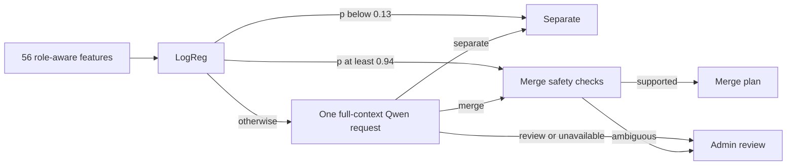

# `dedup` stage (and `pauk dedup graph`)

**What this covers:** the rules for merging duplicate persons, publications and
repositories, and how dedup within a group differs from dedup across the whole
graph.

**Files involved:** `pauk/pipeline/stages/dedup.py`, `pauk/graph/dedup.py`.

Collapses prepared-layer records that describe the same real entity: a person,
a publication or a repository. It runs after every stage that loads anything,
since it works on their output. Only the stages that need already-folded
records come after it in `ALL_STAGES`: `github_match` and `author_names`.

Two levels share the logic but differ in where rows come from:

| | `pipeline/stages/dedup.py` | `graph/dedup.py` |
|---|---|---|
| Command | part of `pauk enrich` / `pauk run` | `pauk dedup graph`, separate |
| Sees | one group | the whole Neo4j graph, all published groups |
| Row source | MongoDB (prepared, own group) | Cypher queries on the graph |
| Writes to | MongoDB + journal in `data/audit/<group>/` | Neo4j + journal in `data/cache/` |
| Why separate | catches duplicates within one collection run | catches duplicates whose records came from **different** runs and never met in one group |

The merge rules (`plan_person_merges`, the ranking of publications and
repositories) are shared: `graph/dedup.py` imports them from
`pipeline/stages/dedup.py` rather than duplicating them.

## Persons

The rule-based planner (`plan_person_merges`, the fallback when the resolver
below is disabled) uses four sources of evidence for a match:

1. **ORCID**: two persons with the same ORCID are one person. Different ORCIDs
   are explicit evidence to the contrary: the pair is never merged and does not
   even enter the journal (there is nothing to report).
2. **Name variant**: one person's display name is among the other's
   `name_variants`, both are ITMO, and they share at least one coauthor.
3. **Identical full name plus corroboration**: both are ITMO, the name has
   several tokens, it is not given as initials, and at least one of these
   holds: a shared coauthor, a shared department, a shared research field
   (`Publication.fields`).
4. **Staff record**: both are ITMO and their names resolve to the same row of
   the official ITMO staff catalog. One row is one employee, so this bridges
   spellings the other rules cannot.

**A name is evidence, not proof.** Transliteration collapses distinct Russian
names into one Latin string, and common surnames (Smirnov, Novikov, Ivanov)
collide inside one university's author pool. An audit of name-only merging
found a real case: "I. V. Smirnov", a reviewer on medical anthropology, merged
with "I. V. Smirnov" the chemist. An explicitly different identity field
(ORCID, email, GitHub login, Google Scholar id, staff record) keeps a pair
apart for good, even if everything else matches. Pairs with weak evidence (a
variant without a shared coauthor, a namesake outside ITMO, a single-token
name, an identical name with no corroboration) are never merged automatically.
They go into the journal with a reason and stay separate until someone confirms
them by hand.

**Candidate generation.** Surname-aware blocking handles token order,
transliteration and compound names. Given names and initials alone are not
blocking keys. Matching ORCID and staff IDs are independent channels.
Ambiguous name matches require additional context; bucket size is not silently
truncated.

**Group conflict.** Identity-compatible subgroups may merge, but ambiguous
bridges remain in review. Explicit operator separations and conflicting identity
fields cannot be bypassed through a third person.

### Confidence-based resolver

Both the prepared-data stage and graph dedup use the same resolver by default:

`pipeline/person_role_features.py` defines the fitted features;
`graph/person_resolution_single.py` defines the single-judge contract.
`pipeline/person_resolution_planner.py` builds the plan, while
`pipeline/person_resolution.py` handles model calls and caching.

`graph/artifacts/person_resolution_logreg.pkl` contains the fitted scaler,
coefficients and frozen surname frequencies for the `roles_v3_raw56` contract.
The feature schema is validated before inference. Training used 388 annotated
pairs and 360 synthetic training examples. Replace the trusted data-only pickle
through `PAUK_PERSON_RESOLUTION_LOGREG_MODEL_PATH`; code and feature contract
must match the artifact.

The features combine role-aligned surname/given-name compatibility, token and
transliteration similarity, identifiers, catalog status, publications,
collaborators and institutional context. The single Qwen request includes
both researcher contexts and computed name facts, without the LogReg score or
a previous model verdict. It returns `merge`, `separate` or `review`.

Role alignment prefers explicit and primary readings over alphabetical order.
Unresolved reversed names use the more frequent surname interpretation; missing
surname frequencies provide no rarity evidence. Identical or reordered full names
without shared publications or collaborators require Qwen even above the local
merge threshold, unless a matching trusted identifier establishes identity.

Matching identifiers with incompatible primary names require review. Initials-only
matches without independent small-team collaborators also require review unless
a matching trusted identifier supports them. These checks apply to both local
and Qwen merge proposals. Missing evidence alone is not a separation rule.

Settings: `PAUK_PERSON_RESOLUTION_ENABLED`,
`PAUK_PERSON_RESOLUTION_MODEL`, `PAUK_PERSON_RESOLUTION_LOGREG_MODEL_PATH`,
`PAUK_PERSON_RESOLUTION_CONCURRENCY`, `PAUK_PERSON_RESOLUTION_SEPARATE_BELOW`
and `PAUK_PERSON_RESOLUTION_MERGE_FROM`. Defaults are defined in
`pauk/person_resolution_defaults.py`. Qwen confidence is descriptive; it is
not an additional merge threshold. Missing/invalid responses go to review.
Cache keys include the model, prompt and evidence, but not the transient pair
number. Retries are reserved for failed or invalid responses.

Held pairs are stored in `review_pairs` with their input route and model verdict
for the admin panel. Automatically separated pairs retire obsolete unanswered
questions. Existing operator decisions remain authoritative.

## Publications

One work reaches OpenAlex by several routes: a preprint and a version of
record, a dataset or software deposit, a re-indexed duplicate of one DOI. Rows
sharing a DOI or a title are one publication. The merge is lossless: each
record is folded into `versions` (`PublicationVersion`: the title, DOI,
journal, date, abstract and authors of that particular record), so every place
the work appeared stays available on the surviving row.

The representative of the surviving row: `article` > other types (including a
missing type) > `preprint`; on a tie, the newer date, then more authors, then
the id as the last tiebreaker.

**The version ledger (`versions`) is rebuilt from raw data, not from the
previous state** (`_refresh_version_ledger`). An entry written after a merge
would describe the merged state (the union of authors of all merged records)
instead of what that record carried. Only the raw `openalex_works` collection
remains a correct per-record source.

When publications merge, `Publication.code_url` is combined alongside
`versions` and `pdf_urls`. `RepoLink` rows are repointed to the survivor;
equal normalized URLs become one `CodeLink` whose occurrences are the
deduplicated union of all versions' `LinkOccurrence` entries. A preprint's
context therefore survives even when the journal record is canonical.
Matching classifications are retained; contradictory verdicts reset the
combined `CodeLink` to `pending` and clear the publication's `link_relevance`
processing state so the next run judges all contexts together. The last fully
calculated `code_url` and `Repository.publication_ids` are kept until the
retry succeeds, as they are on a transient LLM failure.

## Repositories

The same `github_id` means the same repository even if the URLs have diverged
(rename or ownership transfer). For rows whose `github_id` is not known yet
(the `repositories` stage did not finish or failed), the fallback is a match on
the normalized `url`. Also, a URL cited by two different rows signals a rename
between runs: the old row holds the citation under the old name, and the new
one was created under the URL already canonicalized by the server. Every URL
under which a repository was ever cited accumulates in `cited_urls`.

## The journal: nothing is lost, nothing is trusted blindly

`dedup_candidates.jsonl` (in `data/audit/<group>/`) and
`dedup_candidates_graph.jsonl` (in `data/cache/`) record every decision. Applied
merges have status `merged` and the rule that justified them (for audit and a
possible rollback through `merged_ids`); deferred pairs and groups have status
`held` and their reasons. No heuristic stays invisible.

Held items also go to Mongo, into the question queue (`pauk/storage/review.py`,
collection `review_pairs`), where a person answers them in the admin panel.
Answers are read **before** the rules, by both call sites of
`plan_person_merges`: "same person" merges the pair with the rule `manual`,
"different" keeps it apart. The rules are still evaluated in full: if a pair
answered "different" would now pass by a rule, it is not merged but written as a
`disputed` row for a person to look at. An answer does not override the group
contradiction check: a group with two ORCIDs is rejected even if someone said
"same person". An answer is stored under ids that dedup may have already
folded, so answers are read through the `merged_ids` map (`folded_ids` for
rows, `fetch_merged_id_map` for the graph). `merge_rank` decides which of a
pair survives, one rule for dedup and for the panel.

## Graph dedup does not break published links

`Neo4jClient._fold_nodes_batch` moves all incoming and outgoing relationships
from the duplicate to the canonical node (an existing relationship of the
canonical node wins on conflict; the duplicate's properties only fill gaps) and
deletes the duplicate only after the move. `merged_ids` stays on the canonical
node. If a later `publish graph` from an **older** group tries to resurrect an
id already folded by graph dedup, `jsonl_loader.py` re-folds it at the end of
the load (`fetch_merged_id_map`) without waiting for the next
`pauk dedup graph`.
