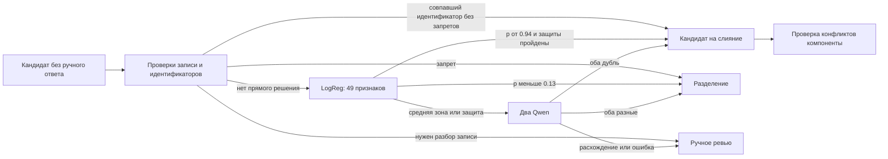

# Дедупликация

Дедуп объединяет записи персон, публикаций и репозиториев. В стандартном
пайплайне выполняется после `repo_people`, перед `github_match` и `author_names`.

| Режим | Источник | Результат |
|---|---|---|
| Стадия `dedup` в `pauk enrich` / `pauk run` | Prepared-данные группы в MongoDB | Обновлённые записи и журнал группы |
| `pauk dedup graph` — отдельная команда | Весь Neo4j | Обновлённый граф и журнал в `data/cache/` |

Для персон оба режима используют `plan_person_merges_resolved`. При
`PAUK_PERSON_RESOLUTION_ENABLED=false` включается прежний `plan_person_merges`:
эвристики по идентификаторам, вариантам имени и подтверждающим связям, без Qwen.

## Персоны: кандидаты → LogReg → Qwen

Блокировка предлагает пары для сравнения; решение о слиянии принимает resolver.
Перед применением слияний проверяются конфликты внутри компонент.

### Генерация кандидатов

`pipeline/person_name_blocking.py` использует фамильные формы и начало имени,
близкие написания, обратный порядок и составные фамилии. Нормализуются
транслитерация, диакритика, смешанные алфавиты, апострофы и дефисы.
ORCID, staff ID и одинаковое многотокенное полное имя — отдельные каналы.
Совпадение ключа только допускает сравнение.

Части дефисного токена наследуют достоверность исходной фамильной формы.
Разбор неявных форм зависит от корпуса; если фильтр исключил все формы,
сохраняется контекстная фамильная форма. При пустом основном имени
сохраняется единственный полный алиас либо согласованные между собой алиасы;
противоречащие варианты не создают независимые корзины. Для записи только с фамилией
принимаются алиасы с совместимой фамилией.
Лимита корзины в 64 персоны нет. Для неразличимых тёзок число пар может
расти квадратично. Резервный канал по совместным работам и соавторам
использует коллективы до 50 авторов в доступном наборе.

Графовая проекция передаёт `name_variants`, `other_names`, `surname_ru/en`
и `first_name_ru/en` тем же правилам блокировки, что и prepared-слой.

### Решение по паре

Resolver сначала направляет карточки с несколькими людьми в ревью, затем
проверяет сравнимость имени, конфликты ORCID/staff ID/профилей/инициалов и
анонимные записи. Совпавшие ORCID или staff ID разрешают слияние после
этих проверок. Конфликт инициалов с совпавшим идентификатором даёт ревью.

| Условие после проверок | Решение |
|---|---|
| `p < 0.13` | Авторазделение |
| `0.13 <= p < 0.94` | Два запроса Qwen |
| `p >= 0.94` | Автослияние либо Qwen при срабатывании защиты |
| Два «дубль» | Слияние |
| Два «разные» | Разделение |
| Расхождение, недоступный или невалидный ответ | Ручное ревью |

Защиты перед автослиянием:

- `large_team_support`: высокий score без поддержки массового соавторства
  перестаёт быть высоким — пара передаётся Qwen.
- `surname_mismatch`: несовместимые полные токены имени передаются Qwen,
  в том числе при общих публикациях и соавторах.

Оба Qwen получают общий блок `identity_facts`. Первый запрос компактный,
второй содержит расширенный контекст, но не получает первый вердикт,
score LogReg и прогноз прироста связей (`as_judge_payload`). Это два запроса
одной модели с разным контекстом. Промпт и payload входят в ключ кэша.

### Модель и настройки

LogReg содержит 49 признаков и хранится в
`pauk/graph/artifacts/person_resolution_logreg.pkl`. Обучение: 388 реальных
размеченных пар (279 дублей, 109 разных людей) и 360 синтетических
отрицательных примеров. Нормализация признаков LogReg и разбор имён при
блокировке разделены; изменение признаков требует переобучения.

| Настройка | По умолчанию |
|---|---|
| `PAUK_PERSON_RESOLUTION_ENABLED` | `true` |
| `PAUK_PERSON_RESOLUTION_MODEL` | `qwen/qwen3-next-80b-a3b-instruct` |
| `PAUK_PERSON_RESOLUTION_CONCURRENCY` | `8` |
| `PAUK_PERSON_RESOLUTION_SEPARATE_BELOW` | `0.13` |
| `PAUK_PERSON_RESOLUTION_MERGE_FROM` | `0.94` |
| `PAUK_PERSON_RESOLUTION_LOGREG_MODEL_PATH` | Путь к указанному pickle |

Порядок и состав признаков артефакта проверяются при загрузке.
Дефолты `Settings` и `ResolverPolicy` берутся из `person_resolution_defaults.py`. Без ключа OpenRouter
локальные решения сохраняются, а пары, требующие Qwen, переходят в `held`.

### Результат проверки

В проверке от 12 октября 2026 года на 139 размеченных парах два Qwen
допустили 6 ложных слияний — **4,3% от всех проверенных пар**.

Профиль `0.13/0.94`, проверка 13 октября на 388 размеченных парах:

| Проверка | Автослияния / ошибочные | Авторазделения / ошибочные | На Qwen |
|---|---|---|---|
| Текущий resolver, повтор обучающей выборки | 146 / 0 | 57 / 3 | 185 |
| Сохранённые групповые OOF-score LogReg | 140 / 4 | 48 / 3 | 200 |

Это проверка на данных разработки; OOF использовался при подборе модели.
Числа до Qwen, не качество финального графа.

### Компоненты и ручное ревью

Компоненты с конфликтующими идентификаторами разделяются. Запись без
идентификатора присоединяется к единственному ближайшему корню по
положительным связям. Равноудалённые записи остаются раздельными на ревью,
даже если между ними есть положительные связи. Противоречащие ручные ответы
блокируют компоненту.

`held` поступает в MongoDB `review_pairs` и отображается на панели.
Ручное «один человек» предлагает слияние, «разные» запрещает его;
проверка конфликтов компонент сохраняется. Ответы сопоставляются через
`merged_ids`. В обоих планировщиках ручное слияние карточки с несколькими
людьми становится `disputed`, включая пары вне текущей блокировки.

Журналы `dedup_candidates.jsonl` и `dedup_candidates_graph.jsonl` содержат
слияния, авторазделения (`separate`), отложенные и спорные случаи. Для расхождения
Qwen сохраняются оба вердикта, confidence, причины, support/risk и исходный
маршрут в `input_route`; эти данные передаются в очередь ревью и доступны
в раскрываемом блоке «Ответы Qwen» на панели.
При сбое второго запроса сохраняется первый ответ. Авторазделение снимает
старый неотвеченный вопрос с очереди, включая вопросы под прежними ID;
ручной ответ не меняется. Повторный `held` возвращает вопрос в очередь.

## Публикации и репозитории

Публикации сопоставляются по DOI или нормализованному заголовку. Основная
запись выбирается по типу (`article` выше прочих, `preprint` ниже), затем
дате, числу авторов и ID. `versions` перестраивается из сырых
`openalex_works`, сохраняя сведения отдельных версий.

Репозитории сопоставляются по `github_id`, при его отсутствии — по
нормализованному URL. Исходные адреса сохраняются в `cited_urls`.

## Сохранение данных

Prepared-дедуп объединяет списки и заполняет пустые скалярные поля основной
карточки. Графовый дедуп записывает из проекции только `is_itmo`,
`name_variants`, `merged_ids`; остальные свойства объединяются из полных
узлов. Входящие и исходящие связи переносятся до удаления дублей.

`AUTHORED.is_corresponding` объединяется через OR: положительное значение
сохраняется. Для остальных свойств связи приоритет у канонического ребра;
если значения нет, приоритет у ближайшего к каноническому узлу участника
цепочки. При одинаковой глубине используется порядок переданных слияний,
для параллельных рёбер одного источника — `elementId`.
`merged_ids` защищает от повторного создания дубля при публикации старой группы.

Отмена слияния использует prepared-строки. Пересчёт оставшихся связей требует
покрытия всех оставшихся участников: агрегированная prepared-строка покрывает
также свои `merged_ids`. При нехватке источников агрегированные данные
сохраняются. Без строки выделяемого дубля либо если оставшаяся prepared-строка
уже включает выделяемого участника возвращается `NothingToRebuild` до записи.
Подробнее — [схема и операции графа](../neo4j-graph.md).

## Файлы реализации

| Файл в `pauk/` | Назначение |
|---|---|
| `pipeline/person_name_blocking.py` | Кандидатные пары |
| `graph/person_resolution.py` | Признаки, правила и промпты |
| `pipeline/person_resolution.py` | Вызовы Qwen и кэш |
| `pipeline/person_resolution_planner.py` | План слияний и ревью |
| `pipeline/stages/dedup.py` | Стадия, legacy-правила, проверка компонент |
| `graph/dedup.py` | Применение дедупа к Neo4j |
