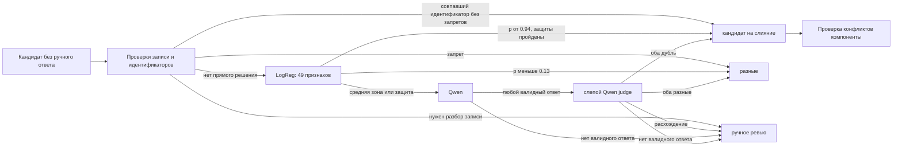

# `dedup` — стейдж (+ `pauk dedup graph`)

**Что здесь:** правила слияния дублей персон/публикаций/репозиториев и
разница между дедупом внутри группы и дедупом по всему графу.

**Какие файлы задействует:** `pauk/pipeline/stages/dedup.py`,
`pauk/graph/dedup.py`.

Схлопывает записи prepared-слоя, описывающие одну и ту же реальную
сущность — персону, публикацию, репозиторий. Идёт после всех стадий,
которые что-либо загружают, — работает над их результатом. После него в
`ALL_STAGES` остаются только те, кому нужны уже схлопнутые записи:
`github_match` и `author_names`.

Два уровня, общая логика, разные источники строк:

| | `pipeline/stages/dedup.py` | `graph/dedup.py` |
|---|---|---|
| Команда | часть `pauk enrich`/`pauk run` | `pauk dedup graph`, отдельно |
| Видит | одну группу | весь Neo4j, все опубликованные группы |
| Источник строк | MongoDB (prepared, своя группа) | Cypher-запросы к графу |
| Куда пишет | MongoDB + журнал в группе | Neo4j + журнал в `data/cache/` |
| Зачем нужен отдельно | ловит дубли внутри одного сбора | ловит дубли, чьи записи попали из **разных** прогонов и никогда не встречались бок о бок в одной группе |

Для персон по умолчанию используется `plan_person_merges_resolved`
из `pipeline/person_resolution_planner.py`. При отключении
`PAUK_PERSON_RESOLUTION_ENABLED` вызывается прежний `plan_person_merges`
из `pipeline/stages/dedup.py`. Обе точки входа используют эти планировщики,
но состав доступных полей различается (см. ограничения ниже).
Ранжирование публикаций/репозиториев также общее.

## Персоны

Генерация кандидатов и решение о слиянии — разные шаги. Совпадение
фамилии, инициала или ключа блокировки только допускает пару к анализу.
Текущий путь: блокировка по имени/идентификаторам → проверки и LogReg →
два запроса Qwen для неразрешённых пар → проверка компонент слияния.
Ручные ответы учитываются планировщиком отдельно.

Прежние правила «совпавший ORCID», «вариант имени + общий соавтор»,
«одинаковое полное имя + подтверждение», а также каталог сотрудников
остались в `plan_person_merges`. Это отключаемый legacy-путь, а не описание
текущего LogReg + Qwen. Отключение resolver меняет правила принятия решений,
а не просто убирает сетевые вызовы.

**Групповой конфликт.** Слияние транзитивно (A=B, B=C ⇒ A=C по union-find),
но попарные проверки не видят транзитивных противоречий — A и B могут
законно совпасть с мостом-персоной M, но отличаться друг от друга. Если
компонента охватывает несколько значений explicit-поля идентичности, она
разрезается по этим значениям. Записи без конфликтующего идентификатора
присоединяются к единственному ближайшему корню по положительным связям;
равноудалённые записи попадают в отдельную неопределённую группу. Связанные
между собой записи этой группы сейчас могут слиться друг с другом, хотя
не присоединяются к конфликтующим корням. Это не гарантия, что каждый
неоднозначный мост останется отдельным узлом. Разбиение повторяется для
следующего конфликтующего поля, поэтому каждая полученная группа внутренне
непротиворечива. Так сохраняются и точные слияния по ORCID/staff id, и
однозначные записи без идентификатора, а одна ошибочная связь больше не
отменяет всю компоненту. Противоречивые ручные ответы остаются
all-or-nothing: выбирать произвольную половину из A=B, B=C, A≠C нельзя.

### Confidence-based resolver

По умолчанию алгоритм используется и стадией `dedup` внутри группы, и командой
`pauk dedup graph` вместо прежней эвристики. `graph/person_resolution.py`
содержит признаки, prompt-контракты обоих Qwen-этапов, сериализацию
доказательств и конечный автомат решений. Обученные параметры LogReg лежат
отдельно в `graph/artifacts/person_resolution_logreg.pkl` и валидируются при
загрузке. Вызовы моделей, кэширование и журналирование находятся в
`pipeline/person_resolution.py`, а сбор признаков и построение плана слияний —
в `pipeline/person_resolution_planner.py`.

Кандидатные пары строит общий модуль `pipeline/person_name_blocking.py`.
Разобранные поля фамилии и порядок `фамилия, имя` имеют приоритет; для
неоднозначного порядка сохраняются варианты с корпусным подтверждением.
Нормализуются диакритика, смешанные алфавиты, апострофы и разные дефисы.
Титулы в начале имени и отдельные цифровые суффиксы не считаются именами.
Однозначная фамилия из собственных вариантов записи имеет приоритет над
корпусной догадкой; неподтверждённый обратный порядок не получает резервный
допуск только за счёт общих соавторов.
Части составной фамилии допускаются по настоящей границе дефиса или частицы,
а не по произвольному совпадению строкового префикса.

Индекс использует фамилию вместе с началом имени. Дополнительные символьные
ключи позволяют проверить близкие варианты имени с различающимися начальными
буквами; совпадения ключа недостаточно без проверки совместимости. Общие
публикации и соавторы дают резервный канал внутри подходящей фамилии, даже
если имена сильно различаются. Отсутствующее имя не считается конфликтом.
Этот резервный канал использует только публикации с не более чем 50
различными авторами в обрабатываемом наборе. Массовое соавторство не должно
само по себе связывать несовместимые имена. Ограничение не отключает пары
по совместимым именам, точным идентификаторам и идентичному полному имени;
это не ограничение размера фамильной корзины.
ORCID, staff id и идентичные многотокенные display names остаются независимыми
каналами. Они только предлагают сравнение, но не разрешают слияние.

Отсечки целой корзины на 64 персонах больше нет: добавление 65-го однофамильца
не должно удалять уже доступные сравнения. Большие группы разделяются по
свидетельствам, а не обрезаются по числу записей. Для действительно неразличимых
однофамильцев/тёзок квадратичное число сравнений всё ещё возможно: жёсткий лимит
здесь означал бы потерю полноты. Короткие фамилии сопоставляются только точно.

В текущем pickle 49 признаков; он заменяет прежнюю модель с 46 признаками.
Последующие изменения блокировки и контекста Qwen не переобучают этот
артефакт. Нормализация признаков LogReg (`_tokens`, `_surname`) и разбор
ролей имени в блокировке (`parse_name`) — разные реализации. В частности,
модельная `_surname` выбирает последний длинный токен, поэтому обратный
порядок имени может менять признаки. Подменять эту нормализацию без
переобучения и переоценки нельзя.
Перед автоматическим слиянием дополнительно проверяется
порядок-независимая совместимость полных токенов имени. Неподтверждённый
конфликт уходит в модельный разбор маршрутом `surname_mismatch`, только
если нет общих публикаций и общих соавторов. При их наличии эта проверка
сейчас пропускает конфликт полных имён; это известное ограничение, а не
доказательство идентичности.
Проверка противоречащих инициалов учитывает близкое написание фамилии и
разобранный порядок ФИО; отсутствующий инициал конфликтом не считается.
Неуверенный обратный порядок и многобуквенная транслитерация инициалов не
создают жёсткого запрета. Если конфликт инициалов противоречит совпадающему
ORCID/staff id, пара уходит в ревью (`identity_name_conflict`), а не в
авторазделение или автослияние.

Для соавторства отдельно сохраняются исходные числа и подтверждение через
небольшие коллективы (`small_team_shared_coauthors` и
`small_team_shared_publications`). Общие работы самой пары исключаются из
независимых общих соавторов. Исходные 49 признаков и pickle не заменяются:
если высокое решение LogReg перестаёт быть высоким без массового соавторства,
автослияние переводится в Qwen (`large_team_support`), а не в авторазделение.
Оба этапа Qwen получают раздельные счётчики и предупреждение о массовых
коллаборациях. Число авторов оценивается по доступным записям: неполный набор
может недооценить реальный размер коллектива.

Оба запроса получают одинаковый блок `identity_facts`: отношения доверенных
идентификаторов, исходные и small-team счётчики и вычисленное сопоставление
компонентов имён. Сопоставление строится по первичным именам и разобранным
полям фамилии, а не по произвольному совпавшему алиасу. Пропущенный компонент
помечается как отсутствующий, не как противоречащий; неоднозначность порядка
остаётся явной. Совместимость написания сама по себе не доказывает идентичность
и не меняет признаки, pickle или решение LogReg.

Второй запрос является слепым: `as_judge_payload()` исключает первый вердикт,
вероятность LogReg и прогноз прироста связей. Эти поля остаются доступны в
внутреннем контексте `as_payload()` для диагностики, но не отправляются модели.
Изменённый prompt и фактический payload автоматически меняют ключ кэша.
Это две оценки одной моделью с разным контекстом, а не статистически независимые
эксперты; совпадение ответов не гарантирует правильность. Правило консенсуса и
направление ошибок API/расхождений на ревью не меняются.

В активном resolver явные списки полных имён в одной карточке (например,
`Ivan Petrov and Anna Sidorova`) не сливаются как одна персона. Такие пары попадают в ревью с
маршрутом `multiple_people_record`, без вызова Qwen; исходные карточки не
удаляются и автоматически не разбиваются. Старое ручное подтверждение
слияния такой карточки помечается как спорное. Проверка выполняется до
запретов по идентификаторам, поэтому такая карточка уходит в ревью даже
при конфликте ORCID. В legacy-пути дополнительный проход ручных ответов
`same` пока может обойти эту защиту.

После проверки карточки на несколько персон resolver применяет запреты:
отсутствующее сравнимое имя, конфликт ORCID/staff id/профиля/инициалов,
анонимная запись. Совпадающие ORCID или staff id дают слияние только после
этих проверок; конфликт инициалов с совпадающим идентификатором даёт ревью.
Далее используется следующий профиль по умолчанию:

| Условие | Решение до проверки компонент |
|---|---|
| `p < 0.13` | Авторазделение |
| `0.13 <= p < 0.94` | Два запроса Qwen |
| `p >= 0.94` | Автослияние, если не сработали `large_team_support` или `surname_mismatch`; иначе Qwen |
| Два ответа «дубль» / два «разные» | Слияние / разделение |
| Расхождение, недоступный или невалидный ответ | Ручное ревью |

На границе `p = 0.13` пара идёт в Qwen, а не в авторазделение. Значения
по умолчанию сейчас продублированы в `Settings` и `ResolverPolicy`.
При изменении дефолтов их нужно согласовать; настройки окружения
передаются в политику при запуске пайплайна/графового дедупа.

Настройки окружения: `PAUK_PERSON_RESOLUTION_ENABLED`,
`PAUK_PERSON_RESOLUTION_MODEL`, `PAUK_PERSON_RESOLUTION_LOGREG_MODEL_PATH`,
`PAUK_PERSON_RESOLUTION_CONCURRENCY`,
`PAUK_PERSON_RESOLUTION_SEPARATE_BELOW` и
`PAUK_PERSON_RESOLUTION_MERGE_FROM`. Модель по умолчанию —
`qwen/qwen3-next-80b-a3b-instruct`, параллелизм — 8.
Для пары, направленной в Qwen, отсутствие ключа OpenRouter или валидного
ответа означает `held`; локальные решения LogReg/идентификаторов от
наличия ключа не зависят. На пару, прошедшую оба этапа, нужны два модельных
вызова без учёта кэша и повторных попыток. Один запрос с объединённым
промптом — отдельный эксперимент, в этот путь он не включён.
Чтобы заменить LogReg, достаточно положить новый доверенный pickle-артефакт
той же схемы и указать путь в `PAUK_PERSON_RESOLUTION_LOGREG_MODEL_PATH`;
порядок и количество признаков проверяются до первого решения.

Пары со статусом `held` автоматически записываются в очередь ручного ревью,
а решения оператора учитываются в следующем прогоне. Ограничения журнала
и очереди описаны ниже: полного аудита всех рассмотренных пар сейчас нет.

### Обучение и границы оценки качества

Текущий артефакт обучен на 388 размеченных реальных парах (315 прежних и
73 добавленных; 279 дублей и 109 разных людей) и 360 синтетических
отрицательных примерах. Итого 748 обучающих строк — не 374 пары,
продублированные перестановкой участников.

При подборе использовался `GroupKFold` по связанным компонентам персон;
синтетические строки с участниками валидационного фолда исключались из
его обучения. Однако гиперпараметры и пороги выбирались по тем же OOF
результатам: это разработочная оценка, не независимый holdout.

Исторический строгий профиль `0.0624531492 / 0.977407873` и его нулевые
ошибки на проверенной выборке не подтверждают качество текущих
`0.13 / 0.94`, новых промптов или полного production-прогона. Число
слияний на отдельной копии графа также не является метрикой точности.
Для сравнения нужны одинаковые пары, версия модели, промпты, пороги и
отдельный учёт автоошибок, модельных решений и ручного ревью.

### Известные ограничения блокировки и входных данных

- Дефисное имя может ошибочно интерпретироваться как составная фамилия:
  например, `Jean-Pierre Dupont` и `Jean-Pierre Durand` допускаются к
  сравнению. Защита от группировки по общему имени пока не абсолютна.
- Корпусная фильтрация способна убрать все неявные фамильные варианты
  записи. Поэтому отсутствие лимита 64 не гарантирует сохранение всех
  истинных пар при изменении состава входного набора.
- При пустом первичном имени проверка алиасов допускает их без
  подтверждения основным именем; лишние кандидаты всё ещё возможны.
- Графовый путь читает `name_variants`, но не передаёт `surname_ru/en`,
  `first_name_ru/en` и `other_names` в `Person` для планировщика.
  Результат блокировки по графу может отличаться от prepared-слоя.

Эти ограничения и описанный выше пропуск конфликта полных имён при общем
соавторстве остаются в коде; документация не обозначает их как исправленные.

## Публикации

Одна работа доходит до OpenAlex несколькими путями: препринт и версия
записи, депозит датасета/софта, переиндексированный дубликат одного DOI.
Строки с общим DOI или общим заголовком — одна публикация. Слияние
безлосс: каждая запись сворачивается в `versions`
(`PublicationVersion` — заголовок/DOI/журнал/дата/абстракт/авторы именно
этой записи), поэтому все места, где работа появлялась, остаются доступны
на выжившей строке даже после слияния.

Представитель для оставшейся строки: `article` > (прочие типы, включая
отсутствующий) > `preprint`; при равенстве — более новая дата, затем
больше авторов, id как последний тайбрейкер.

**Журнал версий (`versions`) перестраивается из сырых данных, не из
предыдущего состояния** (`_refresh_version_ledger`) — запись, сделанная
после слияния, описывала бы уже объединённое состояние (union авторов
всех слитых записей), а не то, что несла именно эта запись. Только
raw-коллекция `openalex_works` (сырые ответы) остаётся верным по-записно источником.

## Репозитории

`github_id` — тот же репозиторий, даже если URL успел разойтись
(переименование/передача владения). Фолбэк для строк, у которых
`github_id` ещё не известен (стейдж `repositories` не добежал/упал) —
совпадение по нормализованному `url`. Отдельно: URL, процитированный
двумя разными строками — признак переименования между прогонами, старая
строка держит цитату по старому имени, новая заведена под уже
канонизированным URL с сервера. Все URL, под которыми репозиторий когда-либо
цитировался, накапливаются в `cited_urls`.

## Журнал решений и очередь ревью

`dedup_candidates.jsonl` (в группе) / `dedup_candidates_graph.jsonl` (в
`data/cache/`) содержат применённые слияния со
статусом `merged` и правилом, которое их обосновало (для аудита и
возможного отката через `merged_ids`); отложенные пары/группы — статусом
`held`, маршрутом и причинами в одинаковых полях `route`, `reason` и
`held_because`. Счётчики `dedup_component_conflicts` и
`graph_dedup_component_conflicts` отдельно показывают конфликтные компоненты
в итогах прогона. Авторазделения resolver (`hard_veto`, `logreg_low`,
два отрицательных ответа Qwen) отдельными строками не записываются.
Это журнал слияний и отложенных случаев, не полный журнал всех решений.
У строки расхождения Qwen нет обоих вердиктов и их объяснений:
сохраняются общий `reason` и confidence второго ответа; исходный маршрут
до Qwen также теряется. Для подробного разбора нужен дополнительный контекст.

Проверка `person_shared_orcid` в разделе «Дубликаты» показывает ORCID,
которые после прогона всё ещё принадлежат нескольким узлам персон, и даёт
список этих узлов для разбора. В этой проверке нормализация ограничена
регистром и пробелами: URL-форма ORCID и голый идентификатор могут не
сопоставиться, хотя resolver нормализует их.

Отложенное уходит ещё и в Mongo, в очередь вопросов
(`pauk/storage/review.py`, коллекция `review_pairs`), где на него отвечает
человек в панели. Оба планировщика учитывают ответы **до** автоматических
правил: «один человек» предлагает пару с правилом `manual`,
«разные» держит её раздельно. Правила при этом досчитываются до конца: если
пара с ответом «разные» теперь прошла бы по правилу, она не сливается, а
пишется строкой `disputed` — на неё смотрит человек. Проверку группы на
противоречие ответ не отменяет: конфликтующие части группы с двумя ORCID не
сливаются, даже если кто-то сказал «один человек»; точные непротиворечивые
подгруппы при этом могут быть схлопнуты. Ответ хранится под id, которые мог уже
свернуть дедуп, поэтому ответы читаются через карту `merged_ids`
(`folded_ids` для строк, `fetch_merged_id_map` для графа). Кто из пары
остаётся, решает `merge_rank` — одно правило для дедупа и для панели.
Для карточки с несколькими людьми активный resolver вместо ручного
слияния пишет `disputed`, как описано выше. Если ранее отложенная пара
в новом прогоне автоматически разделена, старый открытый вопрос сейчас
не снимается автоматически: размер очереди не равен числу новых `held`.

## Дедуп в графе не рвёт уже опубликованные связи

Карточки `Person`, прочитанные из графа для поиска дублей, являются
неполной проекцией узлов. Их нельзя целиком записывать обратно: значения по умолчанию
затрут непрочитанные `emails`, `other_names`, `affiliations`. Графовый дедуп
записывает только `is_itmo`, `name_variants`, `merged_ids`, а остальные
свойства объединяет из полных сохранённых узлов внутри `_fold_nodes_batch`.
Списки адресов, дополнительных имён и аффилиаций объединяются без повторов;
основные адреса обеих карточек также сохраняются в `emails`. В prepared-слое
`_merge_person` объединяет списки всех полей модели и заполняет отсутствующие
скалярные поля, сохраняя идентификатор основной карточки.

`Neo4jClient._fold_nodes_batch` переносит все входящие/исходящие связи с
дубля на канонический узел (существующая связь канонического узла
побеждает при конфликте, свойства дубля только заполняют пробелы).
Исключение — `AUTHORED.is_corresponding`: итоговое значение является OR
всех исходных значений. Положительное сведение сохраняется при слиянии
людей и публикаций, а также при загрузке повторяющихся записей авторства.
Если признак отсутствует во всех исходных связях, он не создаётся.
Несколько переносимых связей `AUTHORED` группируются по итоговой паре узлов
до записи. OR для `is_corresponding` не зависит от порядка. Для остальных
свойств (`position`, `affiliation` и т. п.) при отсутствии значения у
канонической связи побеждает последнее обработанное; порядок исходных
рёбер в запросе не задан. Детерминированность всех свойств не гарантируется.
Правило OR относится к
агрегированной связи; журнал версий публикации не переписывается.
Дубль удаляется только после переноса. `merged_ids` остаётся на
каноническом узле — если более поздний `publish graph` от **старой**
группы попытается воскресить id, уже схлопнутый графовым дедупом,
`jsonl_loader.py` перефолдит его сразу в конце загрузки
(`fetch_merged_id_map`), не дожидаясь следующего `pauk dedup graph`.

Повторная публикация только основной карточки сохраняет списки, собранные
из дублей. Цепочки сохранённых алиасов разрешаются до конечного узла до
пакетной записи; отношения на старые id загружаются до удаления дублей.
Циклические и противоречивые планы отклоняются до изменения графа.

Отмена слияния пересчитывает отметку контактного автора и снимает лишние
связи только при наличии prepared-строк всех оставшихся участников.
Это не снимок состояния до слияния: обычный дедуп prepared-слоя уже может
удалить строки дублей и объединить основную карточку. При неполном наборе
источников агрегированные поля и связи сохраняются с предупреждением;
сведения выделенного дубля могут остаться также на основной карточке.
Если нет prepared-строки самого выделяемого дубля, восстановление
невозможно (`NothingToRebuild`). Полный откат прежнего состояния не гарантируется.
