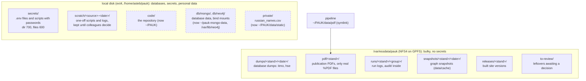

# Server storage layout (einsteinium)

Where PAUK keeps its files on `einsteinium.nsslab`: the small local disk for
what must not sit on a network share, `/var/essdata` (NFS) for everything
bulky. Prose description and the reasons:
[`../architecture/deploy.md`](../architecture/deploy.md#storage-layout).

Solid boxes exist today. Dashed boxes are planned and not moved yet.

`<stand>` is a deployment of PAUK: `itmo` is the main one, `hse` a conserved
demo. A new stand gets its own subfolder in each type folder.
