# Server storage layout

The running Compose mounts on `einsteinium.nsslab`. Details and operational
commands: [deploy.md](../architecture/deploy.md).

```mermaid
flowchart TB
    subgraph LOCAL["Local disk: /home/asteb/pauk"]
        CODE["code/: checkout and deploy/ configuration"]
        DB["db/mongo/; db/neo4j/data/; db/neo4j/plugins/"]
        SECRETS["secrets/pauk.env: mode 600, parent 700"]
        PRIVATE["private/: staff catalog"]
        LOGS["logs/&lt;service&gt;/: rotated service logs"]
        GUI["gui/itmo/: generated public and private map data"]
        SITE["site/itmo/: main, preview, archive-&lt;port&gt;"]
        OPSDATA["ops/: SQLite journal, settings, operation logs"]
    end
    subgraph ESS["NFS: /var/essdata/pauk"]
        PDF["pdf/itmo/: publication PDFs"]
        SNAP["snapshots/itmo/: graph snapshots and dedup journal"]
        RUNS["runs/itmo/: audit/ and osa/"]
        REPORTS["reports/itmo/: index.json and language/PDF files"]
        DUMPS["dumps/&lt;stand&gt;/: database backups"]
        RELEASES["releases/&lt;stand&gt;/: stored site builds"]
        DEPLOYMENTS["deployments/&lt;id&gt;/: source and publication rollback archives"]
    end
    CACHE["Docker volume: deploy_uv-cache"]
    MONGO["mongo"] --> DB
    NEO["neo4j"] --> DB
    ADMIN["admin"] --> LOGS
    WORKER["worker"] --> PRIVATE
    WORKER --> GUI
    WORKER --> LOGS
    WORKER --> PDF
    WORKER --> SNAP
    WORKER --> RUNS
    WORKER --> REPORTS
    WORKER --> CACHE
    NGINX["site: nginx"] --> SITE
    NGINX --> REPORTS
    NGINX --> LOGS
    OPS["ops: control plane"] --> OPSDATA
    OPS --> CODE
    OPS --> SECRETS
    OPS --> SITE
    OPS --> DUMPS
    OPS --> RELEASES
    OPS --> DOCKER["Docker socket"]
```

The worker writes map data to `gui/itmo/`; nginx reads a separately published
build from `site/itmo/`. Rebuilding map data does not publish the site.
Secrets and the staff catalog stay on the local disk. Database data use bind
mounts; the OSA environment cache is a Docker volume.
